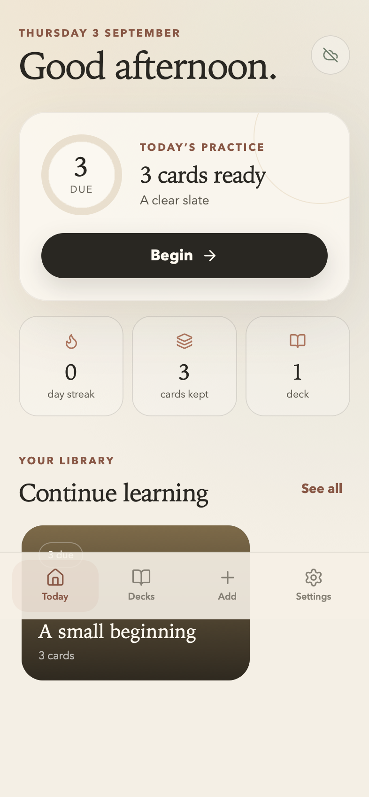

# Lumen

Lumen is a calm, private flashcard app for iPhone and the web. It uses the modern FSRS scheduler to bring each card back when it is useful—not merely every day.



## Install on iPhone

1. Open **<https://tbuckworth.github.io/lumen-cards/>** in Safari.
2. Tap **Share**, then **Add to Home Screen**.
3. Keep **Open as Web App** enabled and tap **Add**.

There is no App Store purchase, developer account, login, API key, or subscription. Wait for **Ready offline** before using the app without a connection. Installing it on the Home Screen alone does not confirm offline readiness.

## What it does

- Schedules reviews with [FSRS](https://github.com/open-spaced-repetition/ts-fsrs). See [Studying](docs/image-decks.md#studying) for daily allowances, session order and **Study ahead**.
- Creates, edits, pauses, deletes, searches, and studies cards in separate decks.
- Supports image cards, portable deck imports and exports, and full backups. See the [deck guide](docs/image-decks.md).
- Shares a learning report containing repeatedly missed cards back to Claude through the iPhone share sheet.
- Installs as a standalone PWA and precaches the complete interface for offline use.

## Claude and reMarkable workflow

The `paper-review` plugin in [`tbuckworth/claude-remote-setup`](https://github.com/tbuckworth/claude-remote-setup) includes a `lumen-flashcards` skill and `/lumen-deck` command. It turns a paper, reMarkable annotations, quiz gaps, or notes into a validated `*.lumen.json` file.

The low-friction route is:

1. Review a paper with Claude and reMarkable, or say **“Make this a Lumen deck.”**
2. Claude saves the deck in **iCloud Drive → Lumen Inbox** when available.
3. On iPhone, open **Lumen → Add → Import → Choose a deck file**.
4. Later, use **Settings → Share progress with Claude** so Claude can diagnose weak or ambiguous cards.

This exchange is deliberately user-mediated. Lumen cannot read Claude conversations and Claude cannot silently read Lumen's local data.

## Data and privacy

Cards and review history live in IndexedDB on the current device and origin. Lumen asks the browser for persistent storage but browsers retain final control, so full backups matter. Use **Settings → Save a full backup** and keep the JSON file in iCloud Drive before changing or resetting a phone.

There is no analytics, advertising, remote database, account system, or application secret. The static site is public; the user's cards are not.

Lumen has no automatic cross-device sync or server-driven reminders; opening the app shows everything due. See [Importing](docs/image-decks.md#importing) for file formats and media limits.

## Development

Use Node.js 24 to match CI, with Git available.

```bash
npm ci
npm run dev
```

Builds run from a Git checkout and write `dist/build-provenance.json` with the source revision, uncommitted-change status and build configuration.

Run the complete local verification:

```bash
npm test
npm run build
npm run test:e2e
```

The Playwright suite covers emulated iPhone WebKit, mobile Chromium, and desktop Chromium. It tests onboarding, FSRS review, persistence, Claude deck import, the PWA manifest, offline reload in browsers whose automation layer supports it, and automated accessibility checks.

See the [offline fixture catalogue](tests/e2e/fixtures/CLAUDE.md) for the worker failure tests. WebKit offline network emulation remains unsupported; these tests do not establish physical-iPhone behavior.

Pull requests and pushes to `main` run the same tests; pushes to `main` build a downloadable release artifact and deploy `dist/` to GitHub Pages only after they pass.

## Design notes

The palette is parchment, sandstone, low amber, sage, and ink. Typography uses system-resident Baskerville/Iowan-style faces and Avenir fallbacks, so the app remains fast and fully offline without a font CDN.

Lumen is not affiliated with Anki. FSRS and `ts-fsrs` are open-source projects used under their respective licences.
